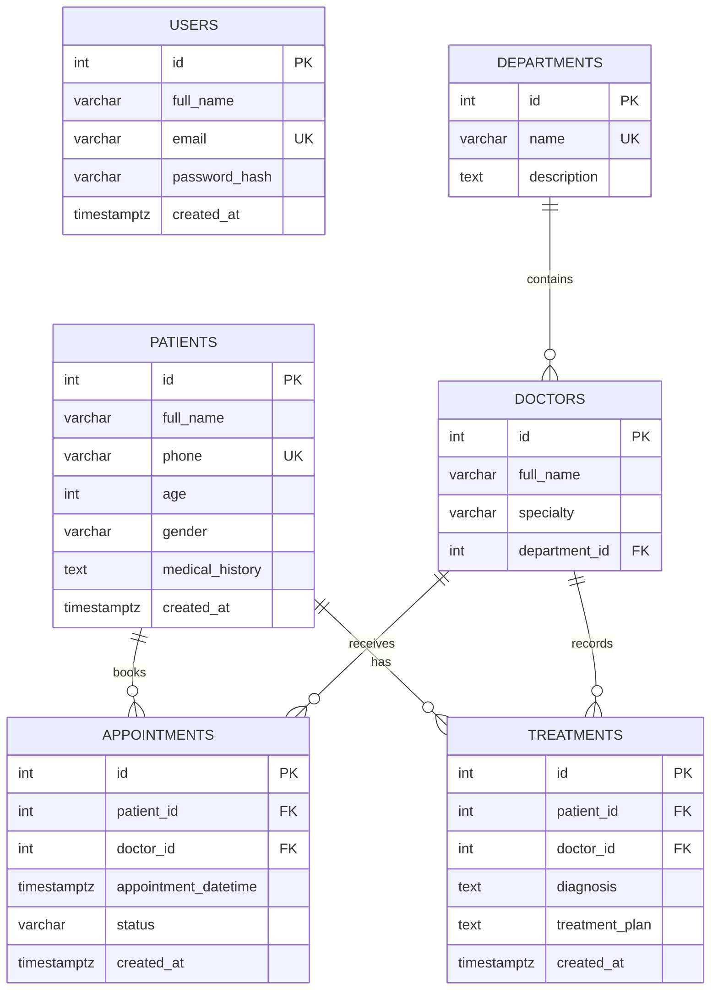

# Database and Testing Documentation

## 1. Database Overview

The Healthcare AI Agent uses PostgreSQL to store fictional clinic data.

The database contains six related tables:

1. `users`
2. `departments`
3. `doctors`
4. `patients`
5. `appointments`
6. `treatments`

The schema is created by:

```text
backend/migrations/001_initial_schema.sql
```

Fictional demonstration records are inserted by:

```text
backend/migrations/002_seed_demo_data.sql
```

---

## 2. Entity Relationship Diagram



---

## 3. Table Descriptions

### 3.1 Users

Stores application user accounts.

Important fields:

- `id`: Primary key.
- `full_name`: User's display name.
- `email`: Unique login email.
- `password_hash`: Hashed password value.
- `created_at`: Account creation timestamp.

The database prevents duplicate email addresses and blank names or emails.

### 3.2 Departments

Stores clinic departments such as cardiology or neurology.

Important fields:

- `id`: Primary key.
- `name`: Unique department name.
- `description`: Optional department description.

A department can contain multiple doctors.

### 3.3 Doctors

Stores doctor profiles.

Important fields:

- `id`: Primary key.
- `full_name`: Doctor's full name.
- `specialty`: Doctor's medical specialty.
- `department_id`: Foreign key referencing `departments.id`.

Each doctor belongs to one department.

A department cannot be deleted while doctors still reference it.

### 3.4 Patients

Stores fictional demonstration patient information.

Important fields:

- `id`: Primary key.
- `full_name`: Patient's full name.
- `phone`: Optional unique phone number.
- `age`: Optional age between 0 and 130.
- `gender`: Optional value of `M`, `F`, or `Other`.
- `medical_history`: Optional medical-history note.
- `created_at`: Record creation timestamp.

Only fictional patient data is used in this academic project.

### 3.5 Appointments

Stores scheduled clinic appointments.

Important fields:

- `id`: Primary key.
- `patient_id`: Foreign key referencing `patients.id`.
- `doctor_id`: Foreign key referencing `doctors.id`.
- `appointment_datetime`: Appointment date and time.
- `status`: `scheduled`, `cancelled`, or `completed`.
- `created_at`: Record creation timestamp.

Each appointment belongs to one patient and one doctor.

The database prevents:

- Two active appointments for the same doctor at the same time.
- Two active appointments for the same patient at the same time.

Cancelled appointments do not block the same time slot.

### 3.6 Treatments

Stores diagnoses and treatment plans.

Important fields:

- `id`: Primary key.
- `patient_id`: Foreign key referencing `patients.id`.
- `doctor_id`: Foreign key referencing `doctors.id`.
- `diagnosis`: Required diagnosis text.
- `treatment_plan`: Optional treatment-plan text.
- `created_at`: Record creation timestamp.

Each treatment connects one patient with the doctor who recorded it.

---

## 4. Relationship Summary

| Parent table | Child table | Relationship |
|---|---|---|
| `departments` | `doctors` | One department has many doctors |
| `patients` | `appointments` | One patient has many appointments |
| `doctors` | `appointments` | One doctor has many appointments |
| `patients` | `treatments` | One patient has many treatment records |
| `doctors` | `treatments` | One doctor records many treatments |

The `users` table is currently independent from the clinic-domain tables.

---

## 5. Database Integrity

The schema uses several database-level protections.

### Primary keys

Every table has a generated integer primary key.

### Foreign keys

Foreign keys protect relationships between:

- Doctors and departments.
- Appointments and patients.
- Appointments and doctors.
- Treatments and patients.
- Treatments and doctors.

### Check constraints

The database validates:

- Non-blank names.
- Patient age from 0 through 130.
- Supported patient gender values.
- Valid appointment statuses.
- Non-blank treatment diagnoses.

### Unique constraints

The database prevents duplicate:

- User emails.
- Department names.
- Patient phone numbers.
- Active doctor appointment slots.
- Active patient appointment slots.

### Indexes

Indexes improve common searches involving:

- Doctor name and specialty.
- Doctor department.
- Patient name.
- Appointment date, doctor, patient, and status.
- Treatment patient, doctor, and creation time.

---

## 6. Automated Backend Tests

Backend tests are located in:

```text
backend/tests
```

The current test suite contains:

### Gemini response parser tests

```text
GeminiResponseTests.cpp
```

These tests verify that Gemini responses are parsed correctly, including multiple function calls.

### Agent tool registry tests

```text
ToolRegistryTests.cpp
```

These tests verify that all eight required Agent tools are registered and available.

### Gemini conversation tests

```text
GeminiConversationTests.cpp
```

These tests verify conversation construction and the addition of function responses.

### Running the backend tests

After configuring and building the project, run:

```powershell
ctest --test-dir build --output-on-failure
```

Expected result:

```text
100% tests passed, 0 tests failed out of 3
```

When the backend is built inside Docker, the same CTest command can be executed inside the backend container using its configured build directory.

---

## 7. API Smoke Tests

The API smoke-test script is:

```text
scripts/api-smoke-tests.ps1
```

It checks:

1. Backend health.
2. Database health.
3. Department listing.
4. Doctor listing.
5. Patient listing.
6. Appointment listing.
7. Treatment listing.
8. Agent tool registry.
9. Gemini function declarations.
10. Frontend CORS preflight.

Run the script while the backend is available at port `8000`:

```powershell
powershell -ExecutionPolicy Bypass `
    -File scripts/api-smoke-tests.ps1
```

To test another backend address:

```powershell
powershell -ExecutionPolicy Bypass `
    -File scripts/api-smoke-tests.ps1 `
    -BaseUrl "http://localhost:8000"
```

Expected result:

```text
Passed: 10
Failed: 0

All API smoke tests passed.
```

The smoke tests do not consume Gemini API quota because they do not send a live Agent prompt.

---

## 8. Frontend Verification

The React and TypeScript frontend is located in:

```text
frontend
```

### Run the linter

```powershell
npm --prefix frontend run lint
```

Expected result: ESLint completes without errors.

### Create a production build

```powershell
npm --prefix frontend run build
```

Expected result: TypeScript compilation and the Vite production build complete successfully.

---

## 9. Manual Agent Verification

Live Gemini requests require a valid `GEMINI_API_KEY`.

A manual Agent request can be sent to:

```text
POST /agent/run
```

Example request body:

```json
{
  "prompt": "Find Sarah Cohen and list all doctors."
}
```

A successful response includes:

- The final natural-language answer.
- The Gemini provider and model.
- The number of executed steps.
- The Agent tools selected by Gemini.
- The arguments and results of each tool execution.

A multi-step request should demonstrate that Gemini can select and execute several tools before returning one final answer.

Live Gemini verification can fail temporarily when:

- The API key is missing or invalid.
- The free API quota is exhausted.
- Gemini returns a temporary service error.

These external API conditions do not affect the local unit tests, database tests, or API smoke tests.

---

## 10. Final Verification Checklist

Before submission, verify that:

- [ ] PostgreSQL starts successfully.
- [ ] The database health endpoint reports success.
- [ ] All migrations execute successfully.
- [ ] All six database tables exist.
- [ ] All eight Agent tools are registered.
- [ ] All three backend test executables pass.
- [ ] All ten API smoke tests pass.
- [ ] The frontend linter passes.
- [ ] The frontend production build passes.
- [ ] The development Docker Compose stack starts.
- [ ] The production Docker Compose stack starts.
- [ ] The frontend can access the backend through CORS.
- [ ] A live Gemini Agent request works when API quota is available.
- [ ] Only fictional demonstration patient data is included.